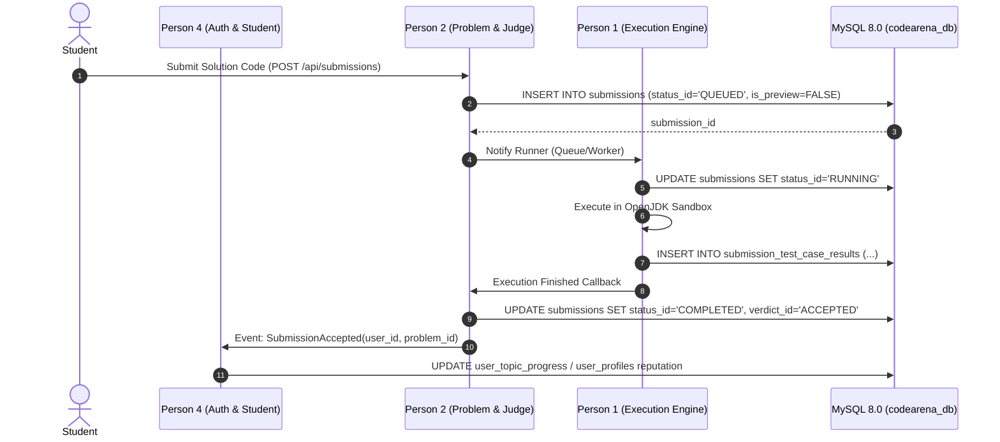

# CodeArena — Backend Team Integration & Ownership Guide

This document defines the architectural boundaries, table ownership, shared contracts, and integration protocols for the four future backend engineers developing the CodeArena platform.

---

## 1. High-Level Responsibility Matrix

| Backend Engineer | Primary Domain | Tables Owned (Primary Write) | Shared Tables (Read / Co-write) |
| :--- | :--- | :--- | :--- |
| **Person 1** | **Java Execution Engine** | `languages`, execution sandbox containers | `submissions`, `submission_statuses`, `submission_test_case_results` |
| **Person 2** | **Problem Management & Judging** | `tracks`, `categories`, `difficulties`, `problems`, `problem_hints`, `problem_test_cases`, `problem_tags`, `problem_tag_mappings`, `submission_verdicts`, `contests`, `contest_problems`, `contest_registrations`, `contest_submissions` | `submissions`, `submission_test_case_results`, `roadmap_topic_problems` |
| **Person 3** | **AI Assistant & Pedagogical Tutor**| `ai_conversations`, `ai_messages` | `problems`, `problem_hints`, `submissions`, `users`, `user_topic_progress` |
| **Person 4** | **Authentication & Student Services**| `roles`, `account_statuses`, `users`, `user_profiles`, `user_oauth_accounts`, `user_preferences`, `user_bookmarks`, `user_recently_viewed`, `roadmap_levels`, `roadmap_topics`, `roadmap_prerequisites`, `user_topic_progress` | `problems`, `submissions`, `contests` |

---

## 2. Person 1: Java Execution Engine

### Role Overview
Responsible for sandboxed compilation and execution of Java source code (using OpenJDK 17 and Docker/firejail/gVisor isolation), measuring execution time, memory usage, and handling stdout/stderr streams.

### Tables Accessed
- **Read**:
  - `languages`: Fetch active compiler flags, timeout limits, and memory maximums.
  - `submissions`: Dequeue pending submissions where `status_id = 1` (`QUEUED`).
  - `problem_test_cases`: Fetch both public (`is_sample = TRUE`) and hidden (`is_sample = FALSE`) test cases for compilation inputs.
- **Write**:
  - `submissions`: Update `status_id` to `2` (`COMPILING`) and `3` (`RUNNING`).
  - `submission_test_case_results`: Insert per-test-case execution metrics (`execution_time_ms`, `memory_used_kb`, `actual_output`, `error_message`).

### Crucial Invariants
1. **Never write to `is_preview`**: Submissions initiated by the real execution engine must always have `is_preview = FALSE`.
2. **Resource Constraints**: Always enforce `problems.time_limit_ms` and `problems.memory_limit_mb` during process execution to prevent denial-of-service loops.

---

## 3. Person 2: Problem Management & Judging

### Role Overview
Responsible for problem catalog CRUD, automated test-suite verification, verdict determination (`ACCEPTED`, `WRONG_ANSWER`, `TIME_LIMIT_EXCEEDED`, etc.), contest tournaments, and overall acceptance rate analytics.

### Tables Accessed
- **Primary Owner**:
  - `problems`, `problem_test_cases`, `problem_hints`, `problem_tags`, `problem_tag_mappings`.
  - `contests`, `contest_problems`, `contest_registrations`, `contest_submissions`.
- **Shared Write with Person 1**:
  - `submissions`: Person 2 reads test-case outcomes from Person 1, calculates final `verdict_id`, increments `test_cases_passed`, updates `judged_at`, and sets `status_id = 4` (`COMPLETED`).
  - If submission was part of a contest, insert entry into `contest_submissions` with ICPC penalty time calculation.

### Crucial Invariants
1. **Hidden Test Cases Security**: When exposing problem details via REST APIs (`/api/problems/{id}`), `problem_test_cases` where `is_sample = FALSE` must NEVER be serialized in responses.
2. **Canonical ID Stability**: The `problems.canonical_id` string must remain immutable as it is referenced by frontend routing and the learning roadmap.

---

## 4. Person 3: AI Assistant & Pedagogical Tutor

### Role Overview
Responsible for context-aware code explanations, progressive hint guidance, syntax error troubleshooting, and conversational chat without giving away full solutions.

### Tables Accessed
- **Primary Owner**:
  - `ai_conversations`: Tracks conversation threads, session titles, and problem associations.
  - `ai_messages`: Records user questions and LLM responses, along with token telemetry (`prompt_tokens`, `completion_tokens`).
- **Read-Only Context Sources**:
  - `problems`: Fetch statement, constraints, and explanation to feed into system prompt.
  - `problem_hints`: Determine which hint tier the user has unlocked.
  - `submissions`: Read student's recent failed submission source code and compiler diagnostics to provide targeted pedagogical feedback.

### Crucial Invariants
1. **Zero Schema Modification**: Person 3 must not create proprietary storage for chat history; use `ai_conversations` and `ai_messages`.
2. **Token Accounting**: Always log `prompt_tokens` and `completion_tokens` on each turn to prevent API quota exhaustion.

---

## 5. Person 4: Authentication & Student Services

### Role Overview
Responsible for user registration, BCrypt/Argon2id password verification, JWT / session cookie issuance, student profile management, roadmap progress tracking, bookmarking, and preference synchronization.

### Tables Accessed
- **Primary Owner**:
  - `roles`, `account_statuses`, `users`, `user_profiles`.
  - `user_preferences`: Theme, editor settings, font sizes.
  - `user_bookmarks`: Problem saving.
  - `user_recently_viewed`: Dashboard history.
  - `user_topic_progress`: Learning roadmap completion tracking.
- **Read Only**:
  - `submissions`: Compute student dashboard statistics (total solved, acceptance rate, streak).
  - `roadmap_topics`: Fetch learning path for student dashboard.

### Crucial Invariants
1. **Password Security**: Store ONLY cryptographic hashes in `users.password_hash` (`$2a$` or `$argon2id$`). Never log or transmit plaintext passwords.
2. **Session / Token Design**: Issue HTTP-only, SameSite cookies or short-lived JWTs referencing `users.id`.
3. **Atomic Progress Updates**: When a student gets an `ACCEPTED` non-preview submission for a problem mapped to a roadmap topic in `roadmap_topic_problems`, update `user_topic_progress` atomically.

---

## 6. Shared Table Concurrency & Transaction Protocol

### Locking & Transaction Rules
- For submission dequeuing, use `SELECT ... FOR UPDATE SKIP LOCKED` on `submissions` to prevent multiple execution workers from contending on the same submission.
- All multi-table updates (e.g. updating submission verdict and awarding contest points) must be wrapped inside a standard InnoDB `START TRANSACTION` ... `COMMIT` block.

