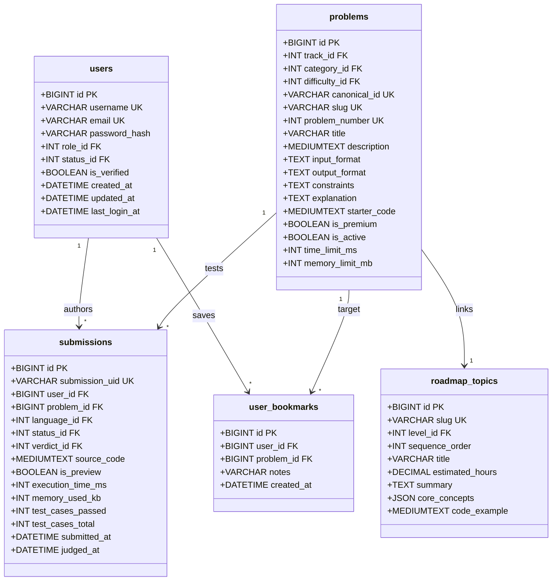

# CodeArena — Entity Relationship Diagram (ERD)

This document visualizes the complete entity-relationship model of CodeArena.

## Conceptual Diagram

```mermaid
erDiagram
    ROLES ||--o{ USERS : "assigned to"
    ACCOUNT_STATUSES ||--o{ USERS : "categorizes"
    USERS ||--|| USER_PROFILES : "extends"
    USERS ||--|| USER_PREFERENCES : "configures"
    USERS ||--o{ USER_OAUTH_ACCOUNTS : "authenticates via"
    USERS ||--o{ USER_BOOKMARKS : "saves"
    USERS ||--o{ USER_RECENTLY_VIEWED : "browses"
    USERS ||--o{ SUBMISSIONS : "authors"
    USERS ||--o{ USER_TOPIC_PROGRESS : "tracks"
    USERS ||--o{ CONTEST_REGISTRATIONS : "enters"
    USERS ||--o{ AI_CONVERSATIONS : "initiates"

    TRACKS ||--o{ CATEGORIES : "contains"
    CATEGORIES ||--o{ PROBLEMS : "classifies"
    DIFFICULTIES ||--o{ PROBLEMS : "rates"
    PROBLEMS ||--o{ PROBLEM_HINTS : "provides"
    PROBLEMS ||--o{ PROBLEM_TEST_CASES : "evaluates"
    PROBLEMS ||--o{ PROBLEM_TAG_MAPPINGS : "tagged by"
    PROBLEM_TAGS ||--o{ PROBLEM_TAG_MAPPINGS : "associates"

    LANGUAGES ||--o{ SUBMISSIONS : "compiles in"
    SUBMISSION_STATUSES ||--o{ SUBMISSIONS : "monitors"
    SUBMISSION_VERDICTS ||--o{ SUBMISSIONS : "grades"
    PROBLEMS ||--o{ SUBMISSIONS : "receives"
    SUBMISSIONS ||--o{ SUBMISSION_TEST_CASE_RESULTS : "details"
    PROBLEM_TEST_CASES ||--o{ SUBMISSION_TEST_CASE_RESULTS : "tested against"

    ROADMAP_LEVELS ||--o{ ROADMAP_TOPICS : "structures"
    ROADMAP_TOPICS ||--o{ ROADMAP_PREREQUISITES : "requires"
    ROADMAP_TOPICS ||--o{ ROADMAP_TOPIC_PROBLEMS : "curates"
    PROBLEMS ||--o{ ROADMAP_TOPIC_PROBLEMS : "mapped in"
    ROADMAP_TOPICS ||--o{ USER_TOPIC_PROGRESS : "recorded in"

    CONTESTS ||--o{ CONTEST_PROBLEMS : "includes"
    PROBLEMS ||--o{ CONTEST_PROBLEMS : "featured in"
    CONTESTS ||--o{ CONTEST_REGISTRATIONS : "lists"
    CONTESTS ||--o{ CONTEST_SUBMISSIONS : "scores"
    SUBMISSIONS ||--|| CONTEST_SUBMISSIONS : "qualifies"

    AI_CONVERSATIONS ||--o{ AI_MESSAGES : "contains"
    PROBLEMS ||--o{ AI_CONVERSATIONS : "contextualizes"
```

---

## Detailed Physical Relational Mapping

